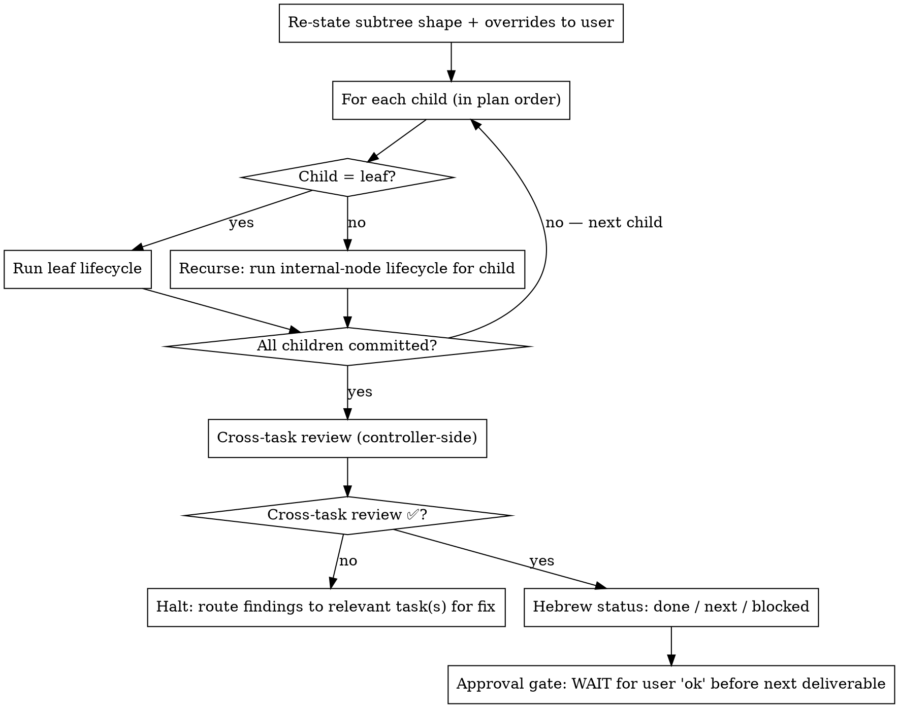

# recursive-execution — Internal node

> Detail for [SKILL.md](SKILL.md). On conflict, SKILL.md §Hard rules wins.

## Behavior — internal node

An internal node is a `### D<n>` deliverable group. Its "implementation" is the completion of all its children plus the cross-task review.

### Internal-node lifecycle

### Cross-task review (the load-bearing addition)

After all children of an internal node have committed, the controller runs four checks. Each produces a written ✅ or ❌ with evidence.

| Check | What to verify | Evidence shape |
|---|---|---|
| **Shared contracts honored across siblings** | `Resolution` fields (D-18), snapshot tables and `index_version` (D-12/D-22), CLI subcommands, seed-file columns (D-42) are consumed exactly as produced | Cite the producing commit + the consuming commit; show the symbol / column / flag matches |
| **No duplicate abstractions** | No two helpers for the same concern (two normalizers, two slug builders, two Levenshtein wrappers) | `grep -rn "def " src/` across the committed range; show no two implementations satisfy the same contract |
| **Shared models consistent** | If two siblings touch the same Pydantic model or constants module, the shape is consistent and nothing re-declares a divergent version | `git diff <subtree_base>..HEAD -- src/models.py src/constants.py` |
| **No merge-order assumptions** | Each sibling commit is independently meaningful and `make test` would pass at it | For each sibling commit: confirm, or document why ordered application was declared in the plan |

**Dispatch shape:** controller-side, read-only tools (Read, Grep, Bash for `git diff`/`grep`). Not delegated.

**No reviewer re-runs here** — the deliverable's review task already ran. The controller confirms it recorded `review: ✅`; a missing verdict is a skipped task — run it now.

**On failure of any check:** halt the subtree-complete claim. Route findings back to the sibling task(s) — re-open, re-dispatch with the specific finding, re-run the review, re-commit.

### Subtree-complete declaration + approval gate (mode-driven)

After all four checks ✅ AND the review task ✅, the controller declares the deliverable complete. The declaration includes: the group id (`D<n>`), the N child commit SHAs, the four check results with evidence pointers, the review verdict, and the Hebrew 3-line status.

| Mode | Deliverable-boundary pause | Plan-root pause |
|---|---|---|
| default | WAIT for `ok` | WAIT for `ok` |
| `auto-accept-edits` | WAIT for `ok` | WAIT for `ok` |
| `auto-mode` / `yolo` | Pass through | Pass through |

When pausing, output: `⏸️ D<n> complete (N commits). Say 'ok' to proceed.`
