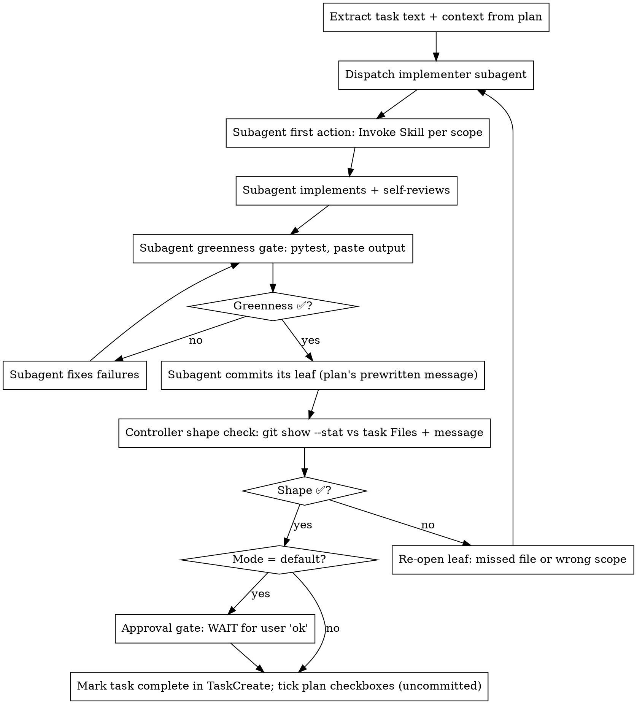

# recursive-execution — Leaf node

> Detail for [SKILL.md](SKILL.md). On conflict, SKILL.md §Hard rules wins.

## Behavior — leaf node

A leaf is a single contained task: fits in one subagent context window AND has no coordination requirement with sibling tasks beyond its parent's cross-task review.

### Leaf lifecycle (controller drives dispatch; subagent commits its own leaf)

> **Shape violations are caught at the agent, not by the controller.** Tests prove behavior; they say nothing about the *shape* of a change. Three levels, cheapest first:
>
> 1. **Mechanized** — a type checker / linter in `make test` (if the plan adds `ruff` or `mypy`, they run inside `verify`). A recurring shape violation becomes a lint rule, not a review step.
> 2. **Subagent self-review, before it commits** — naming honesty, dead code, functions over 20 lines, a literal threshold that belongs in the snapshot, a comment that is not a production stub.
> 3. **Contract fidelity — in the deliverable's review task only**, with the D-xx text in hand.
>
> Per-leaf controller review is deliberately rejected: it spends the controller's context on detection after the commit.



**No reviewer fires inside a leaf.** Reviews run in the plan's review task after the deliverable's 🏁 leaf. At leaf, the only gate before the subagent commits is `guard` (`make test` + extra gate at 🏁).

### Implementer subagent prompt — required shape

The controller constructs the prompt; the subagent never reads the plan file. The prompt MUST include:

- **First action (verbatim):** `Invoke the Skill tool with skill='<name>' before doing anything else.` `<name>` per the task's `Required skill (first step)` line.
- **Full task text** from the plan, including all step bullets, files, expected outputs, and the `**Design:**` line (V3 § + D-xx). Paste the D-xx note text when the leaf implements a scoring or decision rule.
- **Context paragraph** — where this task fits, which siblings ship before/after it, which shared contract it must honor (`Resolution` fields, snapshot tables, CLI subcommands).
- **Hard rule:** `Commit your own leaf after the greenness gate passes, using the plan's prewritten commit message verbatim. git add explicit paths only (no git add . / -A). Do NOT commit before the gate is green.`
- **Code conventions:** `Functions 10–20 lines. No comments except the production-stub notes ex.md asks for. No Any. No magic numbers — thresholds come from the snapshot. Deterministic tie-break (score desc, entity_id asc).`
- **Map rule:** `Never edit challange/ex.mmap. If the design is wrong, return BLOCKED with the node path and the D-xx it conflicts with.`
- **Self-review checklist** from the plan's task block.
- **Question ladder (verbatim):** `Before returning NEEDS_CONTEXT, look for the answer in this order: the task text you were given → ex.mmap Design V3 / Decisions log → ex.md and handoff-deliverables.md → CLAUDE.md. Return NEEDS_CONTEXT only with the list of what you checked and the one question left.`
- **Status report shape** — one of `DONE` / `DONE_WITH_CONCERNS` / `NEEDS_CONTEXT` / `BLOCKED`.
- **Model:** `sonnet` for implementers; `haiku` / `Explore` for a read-only lookup.

### Review task (controller-run, the plan task after each 🏁 leaf)

The controller runs it itself: dispatch one reviewer — `superpowers:requesting-code-review`, `model: 'sonnet'` — with the SHAs, the group's task text and the `ex.md` deliverable bullets; it judges quality and fidelity. Findings reopen the leaf (fix commit, gate re-run, review re-run). Tick the task once it records `review: ✅`. No implementer, no commit. The deliverable's approval gate fires after this task.

### Verification gate (before commit)

The subagent MUST paste the verification command AND its output before it commits. No "should pass".

| Claim | Evidence required |
|---|---|
| Leaf tests pass | `python -m pytest -q tests/<file>` — summary line `N passed` |
| Suite passes (🏁) | `make test` — summary line `N passed` |
| Environment reproducible (🏁 env leaf) | `docker build -t tech-resolver .` exit 0 + one `docker run … idx resolve "AWS"` output |
| CLI behaviour | `make resolve NAME="…"` output pasted |
| DESIGN.md one page | `wc -w DESIGN.md` output |
| Diagram exists | `ls docs/architecture.* docs/resolve-flow.*` output |

Skipped verification = no commit. No exceptions.

### Commit (subagent-side)

```bash
git add <explicit paths from the plan's task — no glob>
git commit -m "<prewritten conventional commit message from the plan's task>"
```

Message copied **verbatim**. If it is wrong, the subagent halts and reports back so the controller can amend the plan first.

### Shape check (controller-side, after every leaf commit)

The controller reads `git show --stat HEAD` and the plan's task block — never the diff:

| Check | Red — re-open the leaf | Flag — ask, then accept |
|---|---|---|
| Files | a path in the task's Create/Modify list is not in the commit | a path in the commit is not in the list |
| Message | type or scope differs from the plan's line | subject wording drifted while intent matches |

Red re-opens the leaf; the subagent fixes, re-runs its gate and commits `fix(<scope>): <miss>`.

### Approval gate (mode-driven)

| Mode | Leaf-level pause |
|---|---|
| default | Output the message below, WAIT for `ok` |
| `auto-accept-edits` | No leaf pause; pause at deliverable boundary |
| `auto-mode` / `yolo` | No pause anywhere |

When pausing:

> ⏸️ Task <N> complete (commit `<short-sha>`). Say 'ok' to proceed to Task <N+1>, or provide feedback.
