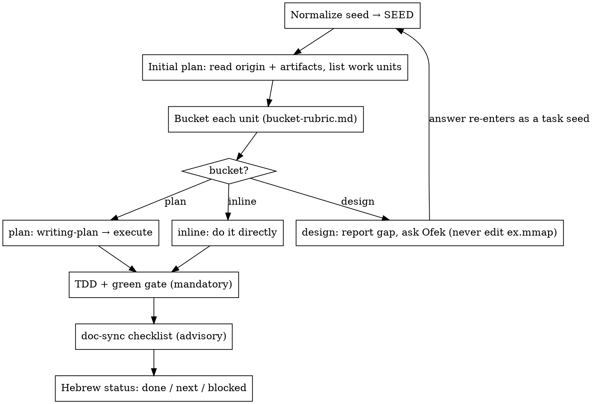

# work-kickoff — SEED contract and pipeline

> Detail for [SKILL.md](SKILL.md). On conflict, SKILL.md §Hard rules wins.

## SEED contract

```
SEED = {
  kind:  deliverable | task | bug,
  origin: <path or ref>,          # "ex.md › Deliverable 4", a chat request, a failing test name
  items: [                        # one or more units of work
    { title, context, artifacts:[<files/map nodes already known>] }
  ]
}
```

| Kind | Normalization |
|---|---|
| `deliverable` | `ex.md` › Deliverable N + the matching `handoff-deliverables.md` row + the `V3 › Doc map` nodes that feed it → one item per deliverable |
| `task` | the chat request → one item |
| `bug` | the failing command + output → one item; routes to the bug-fix two-phase shape |

Everything below the SEED line is identical for all kinds.

## The pipeline


