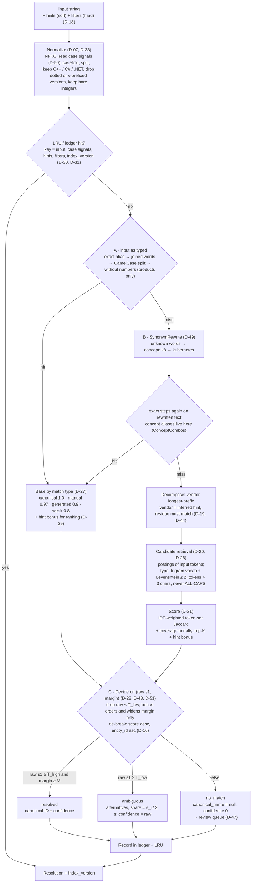

# Resolve flow

Input string → normalization → exact on the input as typed → synonym rewrite → exact + fuzzy on the rewritten text → decision → canonical ID (V3 §6, V4).
Thresholds T_high 0.75, T_low 0.5, M 0.15, K 20 and the hint bonus +0.15 are read from the snapshot (D-28, D-29).

